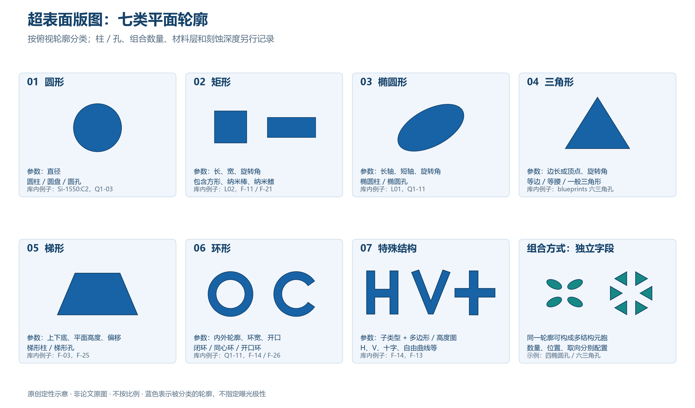
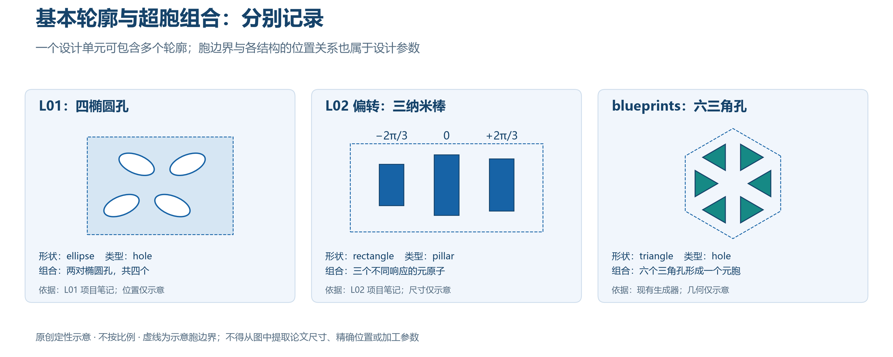

# 超表面元胞形状分类与版图工作流扩展说明

> 更新（2026-10-14，形状分类与版图扩展）：依据仓库已有文献笔记与 `blueprints/` 源码，建立七类俯视轮廓、组合方式及加工标签的统一说明；附原创示意图和各类文献入口。
>
> 证据范围：这是对库内文献和工程代码的分类整理，文献例子的结构描述来自所链接的项目笔记；没有逐篇重新核验所有原始 PDF。示意图是原创定性概括，不是论文原图，不按比例，不能作为尺寸、精确孔位或加工参数来源。
>
> 实现状态：七类是建议采用的分类，不表示生成器已支持七类。当前可执行生成器仍是有限六角光子晶体六三角空气孔路线；本次只补充说明、索引和示意图，不改变已接受仿真及加工配置。

## 1. 分类规则：形状、组合和加工分别记录

建议平面轮廓采用七个稳定类别：**圆形、矩形、椭圆形、三角形、梯形、环形、特殊结构**。

分类对象是俯视图中一个基本结构的轮廓。它是材料柱还是空气孔、一个胞内有几个结构、按什么晶格排列、是否多层或有斜侧壁，属于另外的描述维度。



图 1：七类轮廓及组合示意。蓝色表示被分类的轮廓，不指定材料或曝光区域；闭合环和开口环均归环形。右下角是组合方式示例，不是第八种基本轮廓。图片参数仅用于讲解，不能送入加工设备。

[图 1 矢量版](figures/metasurface_shape_taxonomy.svg)适合缩放及汇报排版。

### 1.1 几个术语的区别

- **基本结构 / meta-atom**：一个柱、孔、纳米棒，或一个具有独立响应定义的结构；在不同论文中用法有差异，应保留原文定义。
- **元胞 / unit cell**：设计或仿真采用的单元，内部可以只有一个结构，也可以包含多个结构。
- **超胞 / supercell**：将多个元原子或基础元胞组合后定义的较大单元，常用于相位梯度或周期倍增。不以结构数量自动判定是否叫“超胞”。
- **晶格 / lattice**：单元中心如何排列，例如方形或三角晶格。六角排列不表示每个孔都是六边形。
- **孔径 / aperture**：整个器件的有效范围，例如圆形超透镜孔径。圆形器件孔径不表示元胞是圆形。

例如 L01 的设计元胞含两对椭圆孔，L02 偏转超胞含三个纳米棒；它们的基本轮廓分别是椭圆和矩形，不需要新增“四孔形”“三棒形”类别。

## 2. 七类轮廓及库内例子

### 2.1 圆形类 `circle`

**包括**：圆柱的俯视轮廓、圆盘、圆形孔。柱高或孔深另行记录。

**建议参数**：直径 `diameter_nm`、中心 `center_um`；统一选直径为输入，避免半径/直径混用。圆对绕自身中心的旋转不改变轮廓，但超胞内的相对位置仍可能重要。

**库内例子**：

- [Si-1550:C2 Arbabi 2015](../../../literature/材料体系分类/Si/1550波段/阅读笔记_C2_Arbabi_2015.md)：熔融石英上的 a-Si:H 圆柱阵列；六角晶格是排列标签。[DOI](https://doi.org/10.1038/ncomms8069)
- [Q1-03 Hsu 2013](../../../literature/Q1_L01相关/阅读笔记_Q1_03_Hsu_2013.md)：圆孔光子晶体平板。[DOI](https://doi.org/10.1038/nature12289)
- [Q1-04 Kang 2022](../../../literature/Q1_L01相关/阅读笔记_Q1_04_Kang_2022.md)：包含圆孔以及圆孔到椭圆孔的形状扰动，允许同时标记圆形与椭圆形。[DOI](https://doi.org/10.1038/s41377-022-00923-4)

**版图注意**：圆弧通常需要离散为多边形，离散误差、地址栅格与修正后的实际直径均需检查；直径相同不保证不同材料/膜厚/激励条件下响应相同。

### 2.2 矩形类 `rectangle`

**包括**：正方形、矩形柱、矩形孔、纳米棒、常规矩形纳米鳍。正方形可表示为长宽相等。若纳米鳍有特殊弯曲轮廓，则按实际轮廓归特殊类。

**建议参数**：长 `length_nm`、宽 `width_nm`、绕自身中心的旋转角 `rotation_deg`，以及有明确需要时的圆角半径。角度基准和正方向统一定义。

**库内例子**：

- [L02 Guo 2020](../../../literature/阅读笔记_L02_Guo_2020.md)：Au/SiO₂/Au 夹层纳米棒；偏转超胞包含三个不同响应的元原子。材料夹层是层结构标签，基本俯视轮廓仍属矩形。[DOI](https://doi.org/10.1126/sciadv.abb4142)
- [F-11 Devlin 2016](../../../literature/材料体系分类/TiO2/阅读笔记_F_11_Devlin_2016.md)：TiO₂ 双折射纳米鳍。[DOI](https://doi.org/10.1073/pnas.1611740113)
- [F-21 Yoon 2020](../../../literature/材料体系分类/TiO2/阅读笔记_F_21_Yoon_2020.md)、[F-22 Choi 2023](../../../literature/材料体系分类/TiO2/阅读笔记_F_22_Choi_2023.md)：各向异性矩形纳米棒/柱及旋转编码。[F-21 DOI](https://doi.org/10.1038/s41467-020-16136-5)、[F-22 DOI](https://doi.org/10.1186/s43074-023-00096-2)

**版图注意**：旋转以后按真实边界计算相邻结构净距；双棒的相对位置、长度差和夹角不能只用一个整体包围盒代替。圆角和刻蚀偏置应与仿真几何对应。

### 2.3 椭圆形类 `ellipse`

**包括**：椭圆柱、椭圆孔、倾斜椭圆以及多个椭圆组成的结构。

**建议参数**：长轴全长 `major_axis_nm`、短轴全长 `minor_axis_nm`、旋转角、每个椭圆相对胞中心的位置。长短轴均为全长，不是半轴；若原论文用带符号扰动描述 x/y 轴，应另保留该原始参数映射，避免排序长短轴后丢失取向信息。

**库内例子**：

- [L01 Huang 2023](../../../literature/阅读笔记_L01_Huang_2023.md)：PMMA 图案层内两对、共四个椭圆孔，配合 Si₃N₄ 波导；两组扰动及取向分别参与辐射控制。[DOI](https://doi.org/10.1038/s41565-023-01360-z)
- [Q1-11 Kühne 2021](../../../literature/Q1_L01相关/阅读笔记_Q1_11_Kuehne_2021.md)：包含倾斜椭圆、非对称双棒和开口环的加工鲁棒性比较，允许在三个形状类别中引用同一笔记。[DOI](https://doi.org/10.1515/nanoph-2021-0391)

**版图注意**：分别检查两轴尺寸、取向、位置及多边形近似；不能因为一个类别在某篇比较中较稳健，就认为所有椭圆器件均能满足同一容差。

### 2.4 三角形类 `triangle`

**包括**：等边、等腰和一般三角形柱/孔。

**建议参数**：等边三角形用边长与旋转角；一般三角形用三个局部坐标顶点。所有顶点单位与顺序明确。圆角采用单独参数，不隐含在生成函数中。

**库内工程例子**：[blueprints 工作流](../../../blueprints/README.md)的元胞包含六个三角空气孔，进一步排列成有限 cavity/cladding 六角壳层。外围六段梯形开窗属于辅助加工区域，不属于每个纳米元胞的形状。

**证据边界**：这是已入库的工程生成器；`source_trace=null`，尚未绑定具体论文轨道，不能作为“某篇论文采用六三角孔”的来源。

**版图注意**：尖角、短边、相邻孔之间剩余材料桥宽都要检查。现有等边三角孔的边长修正公式和 SEM 系数属于该路线专用配置，不应直接移植到其他形状。

### 2.5 梯形类 `trapezoid`

**包括**：俯视为梯形的柱/孔，以及多个梯形的反对称排列。

**建议参数**：上下底长度、平面内两底间距、上底横向偏移和旋转角，或四个局部坐标顶点。这里的“平面高度”与柱高/刻蚀深度必须使用不同字段。

**库内例子**：

- [F-03 Liao 2025](../../../literature/Q1_工艺_L01相关/阅读笔记_F_03_Liao_2025.md)：反对称 Si 梯形柱对。[DOI](https://doi.org/10.1515/nanoph-2025-0406)
- [F-25 Chen 2023](../../../literature/材料体系分类/TiO2/阅读笔记_F_25_Chen_2023.md)：面内梯形孔并结合面外倾斜刻蚀。分类同时保留 `trapezoid` 与三维倾斜工艺标签。[DOI](https://doi.org/10.1038/s41586-022-05467-6)

**版图注意**：L02 等结构因侧壁倾斜而出现的梯形纵截面，不因此改成“梯形平面轮廓”。要分别记录顶面/底面尺寸、侧壁角及采用哪一个参考面生成掩模。

### 2.6 环形类 `ring`

**包括**：圆环、方环、同心环、开口环。开口环可有一个或多个 gap；内外轮廓形状作为子类型。

**建议参数**：内外轮廓尺寸或环宽、开口位置与宽度、环数量及环间净距。不能只保存外径或外边长，内边界决定实际材料区域。

**库内例子**：

- [Q1-11 Kühne 2021](../../../literature/Q1_L01相关/阅读笔记_Q1_11_Kuehne_2021.md)：开口环；环宽和 gap 是关键几何参数。
- [F-14 Huang 2022](../../../literature/材料体系分类/通用交叉/阅读笔记_F_14_Huang_2022.md)：同心环、开口环以及环与其他轮廓的组合。[DOI](https://doi.org/10.1038/s41467-022-33644-8)
- [F-26 Wang 2021](../../../literature/材料体系分类/TiO2/阅读笔记_F_26_Wang_2021.md)：相位/群延迟库包含环形等多种柱截面，同一论文可同时属于圆形、矩形、环形。[DOI](https://doi.org/10.1038/s41467-021-25797-9)

**版图注意**：现有 DXF writer 要求每个 feature 是没有内部环的简单闭合多边形，因此闭合环不能直接把内外轮廓作为一个带孔多边形提交。扩展时需明确分割成简单多边形，或使用支持区域内孔的后端，并回读核验环中空区域与面积；具体分割策略须与平台导入和 PEC 处理一致。

### 2.7 特殊结构类 `special`

难以用以上常规参数统一描述的轮廓均放在此类，但必须保留具体子类型与原始几何来源。

- **字母/天线型**：H、V、十字、其他组合折线轮廓；[F-14](../../../literature/材料体系分类/通用交叉/阅读笔记_F_14_Huang_2022.md)记录了多个图案案例。
- **自由曲线型**：悬链线等连续曲线；F-14 可作为库内阅读入口，需要保留曲线方程或离散点来源。
- **混合轮廓型**：环与十字等组合，可同时记录基本轮廓列表；相互连接、相交或有内孔时需做布尔运算与拓扑检查。
- **三维手性/浮雕型**：[F-13 Gorkunov 2018](../../../literature/材料体系分类/Si/阅读笔记_F_13_Gorkunov_2018.md)的扭转十字/三维浮雕。仅俯视轮廓不足以重建，需高度/深度及加工步骤。[DOI](https://doi.org/10.1038/s41598-018-29977-4)
- **逆设计不规则型**：作为扩展接口预留，保存多边形、二值几何或高度图及来源；[Q1-18 教程笔记](../../../literature/材料体系分类/通用交叉/精读笔记_Q1_18_Gao_Ma_2025_构思结构与术语.md)提供方法背景，不代表仓库已拥有相应制造版图。

**建议参数**：`special_subtype`、几何资产路径/校验和、局部坐标、旋转/镜像变换及需要时的高度信息。“特殊”不是跳过尺寸检查的理由。

## 3. 多结构组合与超胞：独立于形状类别



图 2：L01 四椭圆孔、L02 偏转三纳米棒和现有生成器六三角孔的定性组合。L01 孔位与取向、L02 棒长和相位标注均用于解释数量/响应组合，不复现论文精确几何；六角虚线也不是任何生产边界。[矢量版](figures/metasurface_supercell_composition.svg)

为每个元胞/超胞记录以下内容：

- `primitive_count`：基本结构数量。
- `components`：每个结构的编号、形状、尺寸、相对中心位置、旋转角和所属层。
- `composition_kind`：单结构、二聚体、多结构或混合形状组合。
- `cell_boundary`：胞边界及参考中心；完整器件还记录晶格与孔径。
- `paper_cell_definition`：文献中元胞/超胞的定义和对应出处。

典型归类：

- **L01**：椭圆形 + 孔 + 四结构/两对组合 + PMMA 图案层/Si₃N₄ 波导。
- **L02 偏转**：矩形 + 夹层纳米棒 + 三元原子超胞；材料层与导模激励另记。
- **Q1-11 双棒**：矩形 + 二聚体；不为“双棒”建立第八种基本轮廓。
- **F-03**：梯形 + 柱 + 反对称二聚体。
- **blueprints**：三角形 + 孔 + 六结构组合 + 三角晶格/有限六角器件边界。

## 4. 建议用于工作流的分类字段

以下为设计建议，不是当前 `parameter.json` 已接受的字段；不得直接复制到严格配置中运行。

- `shape_kind`：`circle / rectangle / ellipse / triangle / trapezoid / ring / special`。
- `feature_role`：材料结构、孔或槽；与实际曝光区域/正负胶极性分别定义。
- `geometry_parameters`：对应形状的几何自由度，带单位。
- `composition`：结构数量、各自位置/角度及相对关系。
- `lattice`：方形、矩形、三角晶格或显式位置列表。
- `aperture`：完整器件的边界；独立于基本轮廓和晶格。
- `stack`：材料层、柱高/孔深、侧壁或高度信息。
- `source`：稳定文献编号、DOI、图/页/补充材料定位或工程参数来源。
- `fabrication`：曝光极性、层映射、尺寸偏置、剂量与标定状态。

默认内部坐标以 µm 表示，纳米尺寸字段明确带 `_nm`；旋转角以度表示，建议正角为俯视逆时针且零角沿 +x。长短轴和直径均用全长，规则在配置校验中明确。

同一文献允许多标签，例如 Q1-11 同时关联 `ellipse`、`rectangle`、`ring`；只链接同一份规范笔记，不复制 PDF 或另写三份重复笔记。

## 5. 扩展现有生成器的路线与限制

### 5.1 当前可复用的部分

现有 [GeometrySource 接口](../../../blueprints/workflow/geometry/base.py)与 [LayoutPlan/Feature 数据模型](../../../blueprints/workflow/models.py)接收中性多边形。新几何可沿用这种合同，继续使用通用的尺寸检查、预览和 [DXF 写入回读模块](../../../blueprints/workflow/output/dxf.py)。

但 [CLI](../../../blueprints/workflow/cli.py)当前直接调用 `build_hex_layout`；严格配置、命名、三角孔修正、外围开窗和某些预览/报告字段仍包含原路线的专用逻辑。增加形状函数后，需要同步适配这些入口，并保留旧路线的可复现行为。

### 5.2 建议的阶段

1. **基础轮廓**：先实现圆、矩形、椭圆及三角/梯形多边形，统一单位、角度和曲线离散误差；分别检查几何正确性。
2. **组合与试片**：支持位置列表、二聚体/多结构、均匀阵列与参数扫描；标记与辅助加工窗口单独作为 region。
3. **复杂拓扑**：实现闭合环的内孔、开口环、混合形状和任意轮廓导入；明确孔洞与重叠处理，回读核验面积和拓扑。
4. **响应库驱动器件**：用仿真响应库生成逐点位置/尺寸/角度列表，保留库版本和文献/材料来源；与加工几何之间形成追溯关系。

形状对应不同的主要检查：圆/椭圆检查曲线误差；矩形/梯形检查旋转后的净距与最短边；三角形检查尖角及材料桥宽；环形检查内孔、环宽与 gap；特殊结构检查拓扑和来源完整性。柱/孔的尺寸偏置分别标定。

### 5.3 几何版图与光学设计的连接

相同形状、相同尺寸仍可能因材料、膜厚、波长、衬底、激励方式与邻居不同而具有不同响应。对于波导驱动器件，需要记录导模及传播相位，不能直接把自由空间平面波库当作导模响应库。

几何来源 → 元胞/超胞组合 → 加工修正 → 地址栅格取整 → DRC → 导出/回读是版图链路；目标光场 → 仿真响应库 → 选元分配是上游设计链路。只有完成参数、剂量、极性和生产 DRC 标定后，具体配置才能进入现有 `released` 发布流程。

## 6. 易混情况与阅读边界

- **光栅条/沟槽**：直线条可以由矩形组合实现；聚焦光栅的弯曲沟槽则可归特殊曲线。它们的耦合器功能不能仅由形状类别判断。
- **L 形光栅**：[Q1-17](../../../literature/材料体系分类/通用交叉/阅读笔记_Q1_17_Wang_2024.md)中的 L 形涉及宽度和刻蚀深度构成的纵截面，应按分步刻蚀记录；不能当成一个俯视 L 形多边形就认为可以复现。此项额外核对了[原论文 Fig. 1 与加工段落](https://pmc.ncbi.nlm.nih.gov/articles/PMC10954227/)，其 B1/B2 具有不同宽度和深度，通过两轮套刻/刻蚀形成。
- **三维结构**：斜侧壁、浮雕、多高度、多材料层需要额外工艺/几何信息；二维 DXF 仅保存平面区域。
- **器件外形**：圆形超透镜、环形远场、六角器件边界、环形波导均不自动代表元胞是圆、环或六边形。
- **文献展示与工程能力**：文献中出现某种结构不代表平台能加工，也不代表当前生成器支持。需分别注明 `literature_example`、`engineering_preview` 或未来实测状态。

## 7. 配图来源与复现

两幅配图由项目原创绘制，采用七类基本轮廓和定性组合；没有复制论文图片，也没有由示意图产生生产 DXF。SVG 为矢量版本，PNG 用于网页显示和 PPT 插入。

生成脚本：[render_metasurface_shape_taxonomy.py](../../../scripts/maintenance/render_metasurface_shape_taxonomy.py)。需要 Matplotlib 和 NumPy，使用现有 `blueprints` 环境即可；中文字体可通过 `--font` 指定。

从仓库根目录重新绘图：

```powershell
blueprints/.venv/Scripts/python.exe scripts/maintenance/render_metasurface_shape_taxonomy.py
```

脚本只重绘这两幅说明图的 PNG/SVG，不调用 COMSOL，不创建加工版图，不读取或改写 `main/parameter.json`。
