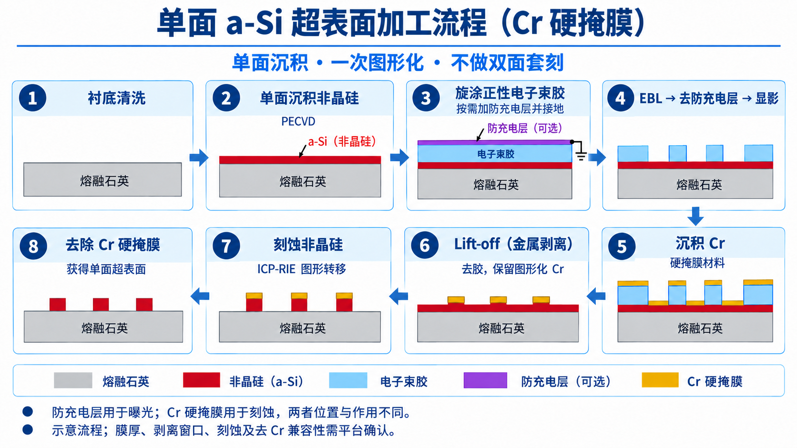
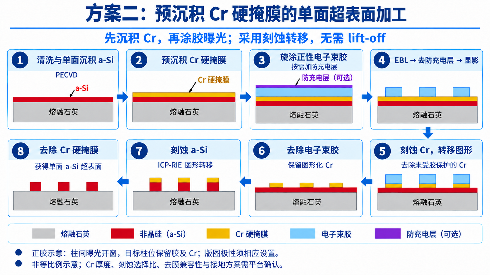

# 单面非晶硅超表面：Cr 硬掩膜两种工艺方案

> 更新（2026-10-22，制备流程图）：按用户要求将双面参考流程改为单面超表面，并将硬掩膜改为 Cr；分别保存后沉积金属剥离路线与预沉积刻蚀转移路线。
> 证据边界：两图为基于用户提供参考图、使用内置图像生成工具重绘的沟通示意，不是论文原图、实际截面照片或已经标定的工艺卡。层厚不按比例，未指定生产 Recipe，不代表已经完成加工。

## 共同目标与边界

- 结构为熔融石英衬底上的**单面非晶硅超表面**；只在正面沉积并图形化，不进行翻面、第二次曝光或双面套刻。
- 硬掩膜采用 Cr，不沿用方案参考图中的 Al 或 SiO₂ 硬掩膜；熔融石英衬底本身仍为 SiO₂ 材料，不因此更换或去除。
- EBL 是在电子束胶中曝光形成图形；随后通过显影、掩膜加工和 a-Si 刻蚀实现图形转移，不把 EBL 表述为直接刻蚀衬底。
- 防充电层与 Cr 硬掩膜按位置和用途分开：前者用于曝光阶段，后者用于目标层刻蚀阶段。是否需要额外防充电层及怎样接地仍需平台确认。
- 图中的 a-Si 是非晶硅示意；实际薄膜是否为 a-Si:H、厚度与光学常数应以实际沉积及测量记录为准。

## 方案一：后沉积 Cr + lift-off

[下载方案一 PNG](figures/2026-10-22_aSi_Cr_scheme1_liftoff.png)

流程：

1. 清洗熔融石英衬底。
2. 单面沉积非晶硅薄膜。
3. 旋涂正性电子束胶；按需配合胶上防充电层和接地。
4. EBL → 去除所用防充电层（若有）→ 显影，形成胶开口。
5. 在显影后的结构上沉积 Cr。
6. **Lift-off（金属剥离）**：去除胶及其上方 Cr，只保留开口中、直接位于 a-Si 上的图形化 Cr。
7. 用 Cr 硬掩膜保护目标柱位，刻蚀 a-Si。
8. 去除 Cr，得到单面非晶硅超表面。

关键点：Cr 在**涂胶、曝光和显影之后**沉积。Lift-off 不是去除用于刻蚀的全部 Cr，而是通过去胶留下需要的金属图形。

## 方案二：预沉积 Cr + 刻蚀转移

[下载方案二 PNG](figures/2026-10-22_aSi_Cr_scheme2_predeposited.png)

流程：

1. 清洗熔融石英衬底并单面沉积 a-Si。
2. 在 a-Si 上预沉积连续 Cr 硬掩膜。
3. 在 Cr 上旋涂正性电子束胶；按需另设胶上防充电层。
4. EBL → 去除所用胶上防充电层（若有）→ 显影。
5. 以胶图形保护目标位置，刻蚀未受保护的 Cr，将图形转移到硬掩膜。
6. 去除电子束胶，保留图形化 Cr。
7. 使用 Cr 图形作为硬掩膜，刻蚀 a-Si。
8. 去除 Cr，得到单面非晶硅超表面。

关键点：Cr 在**涂胶之前**沉积；这条路线通过刻蚀形成 Cr 图形，**不使用 lift-off**。参考图中的 SiO₂ 硬掩膜和 BOE 去膜步骤不直接沿用；Cr 的刻蚀与去除方法需另行确认。

## 版图极性：不能直接互换曝光文件

两图均按正胶示意，但目标柱位置的处理不同：

- 方案一：目标柱位对应胶开口，使 Cr 沉积到 a-Si 上，后续 lift-off 后留下该处 Cr。
- 方案二：目标柱位保留胶，保护其下方 Cr；柱间曝光开窗后刻掉未受保护 Cr。

因此，不能只更改流程名称就复用同一套 EBL 曝光极性。版图“保留柱/刻蚀区/曝光区”的含义、胶的正负性和平台转换设置须一起确认。

## 与平台确认后才能定下的项目

- a-Si 厚度及成分、Cr 厚度、附着和薄膜应力。
- 胶型号/厚度、显影条件、最小尺寸与间距；方案一的金属连续包覆和剥离窗口。
- 方案二 Cr 图形转移的侧向偏差、胶损耗和尺寸保持。
- a-Si:Cr 刻蚀选择比、目标深度、过刻及熔融石英保护。
- 去防充电层、去胶、Cr 刻蚀和最终去 Cr 对其他层的兼容性。
- 连续导电路径、样品夹持接地、充电漂移及邻近效应校正的验证方法。

这些项目未确认前，两条路线均作为讨论方案，不据此填写固定膜厚、剂量或刻蚀机参数，也不改变 L01/L02 已接受结果或项目材料/波长状态。

## 配套资料

- [EBL 与硬掩模术语及工艺顺序](2026-09-09_EBL后硬掩模的作用与工艺顺序.md)：历史材料示例不同，阅读时与本页 Cr 方案区分。
- [2026-09-28 工艺研讨纪要](../consultation/2026-09-28_片上光波导与超表面工艺研讨纪要.md)：口头建议与待验证事项。
- [加工与汇报索引](../README.md#fabrication加工与汇报)。
