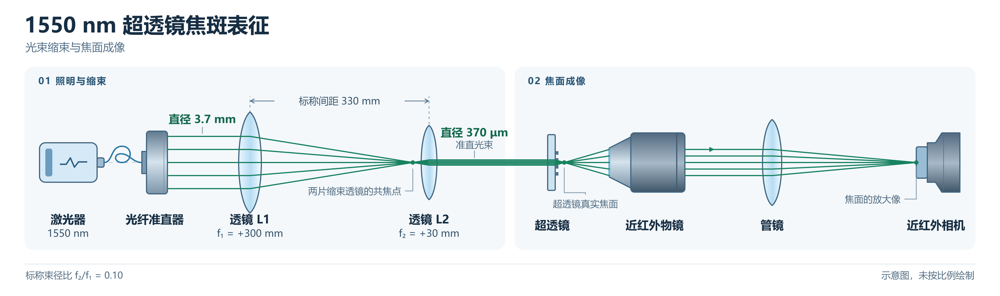

# 1550 nm 超透镜焦斑表征路线

> 更新（2026-11-06，测试方案）：整理 1550 nm 透射式超透镜的缩束照明、轴向扫焦、焦斑分析和聚焦效率测量。该页为待执行的测试方案，器件的实际焦距、NA、焦斑和效率以实测为准。

[可编辑 SVG](figures/2026-11-06_1550nm_metalens_setup_zh.svg) · [相关加工记录（PDF）](2026-11-06_超表面加工流程.pdf)

## 1. 照明与焦面成像

1550 nm 激光 → 光纤准直器（标称束径 3.7 mm）→ +300 mm 透镜 → +30 mm 透镜 → 超透镜 → 真实焦面 → 近红外物镜 → 管镜 → 近红外相机。

- 缩束组按两片正透镜共焦设置，长焦透镜在前。薄透镜近似下，两片相邻主平面的标称间距为 330 mm，束径比为 30/300，输出标称直径为 370 μm。搭建时微调镜间距，在样品面及附近轴向位置确认实际束径与准直状态。
- 按样品设计方向正入射，将入射束居中。标称束径 370 μm 对应约 500 μm 口径样品的中心加权照明。若两者按圆形口径与居中高斯束的 1/e² 强度直径计算，边缘强度约为中心的 2.6%。保存样品面的实测束形和直径定义，仿真对照用同一照明；若需评价充分填充口径的结果，另设照明并记录条件。
- 物镜、管镜及相机均应适配 1550 nm。物镜收集 NA 应覆盖样品出射 NA，工作距离须允许定位图案面与扫焦。用标尺或已知尺寸的标记校准实际物方像素尺寸。按焦斑半高宽跨约 4–5 个像素选取采样倍率。

## 2. 轴向扫焦与焦距

1. 固定样品。用辅助照明把 SiN 或 a-Si 图案面（或同平面标记）成像到相机，将位移台读数记为 z₀。透明衬底的两面需区分。
2. 打开 1550 nm 准直光，将物镜、管镜和相机固定为一个整体沿光轴移动。以设计焦距附近粗扫找到主焦区，再细扫。细扫步长可取预计轴向半高宽的 1/5 至 1/10，随实际焦深调整。
3. 每个位置保存原始灰度图、z 坐标和暗场。固定曝光、增益与像素合并设置，避免主峰饱和。用扣除背景后的主焦斑峰值定位最佳焦面 z_f。对于焦点在空气中的样品，从图案面量起的焦距为 |z_f − z₀|。轴向截面统一强度色标。

## 3. 焦斑 FWHM 与 HCimage Live

在最佳焦面保存二维光强图。在 HCimage Live 中使用 **Line Profile**，穿过主峰分别取 x、y 截线并导出数值。扣除背景后读取两个方向的半高宽，按校准的物方像素尺寸换算成 μm。伪彩用于展示，计算使用原始灰度。整组扫焦帧可用 **Sequence Intensity Analysis** 批量读取相同区域，并与位移台坐标配对。

保存二维焦面图、两条截线及 x–z 或 y–z 光场截面。与设计对照时使用相同波长、入射束形、照明口径和强度宽度定义。

## 4. 聚焦效率（需独立标定功率）

- 分母 P_inc 为落在样品有效口径内的入射功率。保持照明设置，在样品平面用同中心、同直径的参考孔径及功率计测量。
- 分子 P_focus 为指定焦区内的功率。在焦面的放大像面放置针孔，后接 1550 nm 功率探测器。像面孔径直径等于物方积分直径乘以实测倍率。第一轮可选直径 3×FWHM 的积分圆，记录实际孔径；焦斑明显椭圆时同时报告两个方向的 FWHM。
- 扣除暗值并校正收集支路透过率，再算 η = P_focus / P_inc。校正时注意参考束与器件焦束的收集角是否一致。报告时列出波长、样品口径、样品面束径、积分直径、两项原始功率及支路校正值。

参考光路：[Arbabi 等，图 4(c、f、g)](https://pmc.ncbi.nlm.nih.gov/articles/PMC7188898/#Fig4) · [She 等，1550 nm 水平显微镜轴向扫描](https://doi.org/10.1364/OE.26.001573)。
