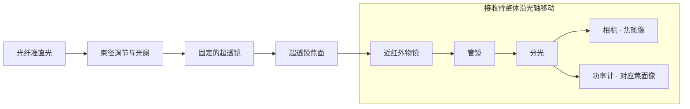

# 透射式超透镜表征光路搭建与汇报

> 更新（2026-11-26，实验思路与汇报）。提炼 Johansen 等 940 nm 实验中的焦面成像和功率标定方法，并用于规划本项目 1550 nm 表征。1550 nm 部分为待验证方案。

**先搭通焦面成像，再做独立功率标定。** 照明臂定义实际入射口径，接收臂把超透镜的焦面放大并移到可测量的位置。轴向扫焦给出焦距，相机记录焦斑形状，功率计给出焦斑内的绝对功率。三类结果共享光路，也各有自己的标定步骤。 [论文 Fig. 2c 与 Methods](https://doi.org/10.1038/s42005-024-01598-6)

[Ansys 超透镜方法对照](../simulation/2026-11-26_Ansys_FDTD_超透镜复现汇报.md)可作为仿真部分，先讲如何从单元库预测整片焦斑，再衔接本页的实际成像和功率标定。

## 1. 光路为什么这样搭

- **照明臂控制照到哪里。** 先确定准直、居中和正入射，再测样品面束形与束径。论文 940 nm 实验的器件直径为 2.5 mm，实际照明约 2.4 ± 0.1 mm。比较不同样品或与仿真对照时，使用相同的束形和口径定义。
- **物镜和管镜把焦面成像到探测端。** 物镜物面与超透镜的真实焦面重合时，相机看到经放大的焦斑。把物镜、管镜及检测端固定成一组，扫焦时保持组内相对位置。物镜需要同时满足波长适配、收集 NA 和工作距离要求。焦面尺寸按实测物方像素尺寸换算。
- **分光后读取两种量。** 相机支路记录二维强度分布，可提取 x、y 两方向半高全宽（FWHM）。功率支路在对应像面内收集指定焦区的功率，标定也从这条支路取数。

正文 Fig. 2c 可用于讲解分光与共轭成像。补图 8 给出了样品照明的横向束形。 [补充材料](https://media.springernature.com/original/springer-static/esm/art%3A10.1038%2Fs42005-024-01598-6/MediaObjects/42005_2024_1598_MOESM1_ESM.pdf)

## 2. 台上按什么顺序调

| 顺序 | 操作 | 调通的标志 |
| --- | --- | --- |
| 1. 照明对中 | 样品先移出，沿预定光轴调准直和束径。记录样品面与附近轴向位置的束形 | 光束通过预定中心，束径和坐标定义有记录 |
| 2. 校准接收臂 | 用同波段可成像的标尺或已知尺寸的标记，校准实际物方像素尺寸。确认焦区可在有效视场内完整成像 | 有物方 μm/像素、接收物镜 NA 和工作距离记录 |
| 3. 定零并扫焦 | 固定样品，定位图案面并记为 z₀。接收臂先粗扫主焦区，再细扫。用扣暗后的主峰定位最佳焦面 z_f | 得到轴上峰值随 z 的曲线、焦距 `abs(z_f - z₀)` 和最佳焦面 |
| 4. 提取焦斑 | 保存不饱和的原始强度帧和暗场。用同一物方标度取两条过峰截线 | 得到二维 PSF、x/y 向 FWHM 与轴向截面 |
| 5. 标定功率 | 对准功率支路的焦区孔径，测入射参考、焦区功率和接收支路传输 | 有原始读数、暗值、积分半径和效率 |

物镜收集 NA 偏小会使大角度光漏收，轴向步进过大容易错过最佳焦面。论文主扫描采用 NA 0.85 的接收物镜，NA 0.86 和 0.93 的效率点受漏收影响。补图 3 的 5 μm 寻焦步长用于说明高 NA 下离焦对 Strehl 比的影响。项目台架的细扫步长应按自己的轴向焦深设置。 [论文 Fig. 2a](https://doi.org/10.1038/s42005-024-01598-6)

## 3. 四次读数如何标定聚焦效率

论文用焦距 50 mm 的折射透镜把参考光送入接收臂，以此求出功率支路透过率。以下编号对应补图 7。四次读数均应按相应探测条件扣除暗值。

| 读数 | 光路状态 | 功率计位置 |
| --- | --- | --- |
| P₁ | 放入参考折射透镜 | 接收臂的成像端 |
| P₂ | 保持参考折射透镜 | 物镜前，直接接收参考透镜汇聚的光 |
| P₃ | 移除参考透镜及待测样品 | 物镜前，直接测准直入射光 |
| P₄ | 放入待测超透镜，接收臂对准真实焦面 | 接收臂的成像端，按指定范围收集焦区功率 |

功率支路透过率 **α = P₁/P₂**，绝对聚焦效率 **FE = P₄/(α × P₃)**。分母是按同一功率支路折算的入射参考。补充说明 Note 2 的一处文字把比值顺序写反了。补图 7 的测点编号和计算步骤对应 **成像端读数 ÷ 物镜前读数**。

论文把收集区域换算到超透镜焦面，为以光轴为中心、**半径 45 μm** 的圆。做自己的样品时，要让分母对应实际落在有效口径内的入射功率。使用像面针孔时，**像面孔径直径 = 2 × 物方积分半径 × 实测倍率**。标定保留功率支路的分光和光阑条件，并核查参考束和待测焦束在接收 NA 下的通过情况。 [补图 7 与补充说明 2](https://media.springernature.com/original/springer-static/esm/art%3A10.1038%2Fs42005-024-01598-6/MediaObjects/42005_2024_1598_MOESM1_ESM.pdf)

## 4. 迁移到 1550 nm 的取舍

- **可以沿用**共同焦面的两路读取、接收臂整体扫焦、参考光路标定，以及用实际积分范围对照实验和仿真的做法。
- **需要重新确定**样品面束径与填充程度、接收 NA、焦深、相机物方采样、功率探测器波长设置和物方积分半径。现有缩束方案的标称输出约 370 μm。评价约 500 μm 样品时，先确认实际照明分布及裁切，再确定仿真和功率分母的口径。
- **固定首轮记录**波长、样品口径、实测束径及定义、物镜 NA、物方像素尺寸、图案面与最佳焦面位置、x/y 向 FWHM、积分半径和原始功率读数。首轮完成后，可用同一口径计算目标焦面与最佳焦面的差异。

项目器件的具体操作和缩束参数见[1550 nm 超透镜焦斑表征路线](2026-11-06_1550nm超透镜焦斑表征路线.md)。

## 5. 四页汇报提纲

| 页 | 标题与配图 | 可以直接讲的话 |
| --- | --- | --- |
| 1 | **为什么要搭两段光路** · 正文 Fig. 2c | “前半段控制照到样品哪里，后半段把焦面搬到相机和功率计能读的位置。我们先把这两个位置对准。” |
| 2 | **怎样从光斑图得到焦距与焦斑宽度** · 正文 Fig. 2b、补图 2 | “固定样品，沿光轴扫接收臂。最亮位置给出焦距，最佳焦面上两条过峰截线给出横向半高全宽。” |
| 3 | **怎样测到可比较的绝对聚焦效率** · 补图 7、正文 Fig. 2a | “先用参考透镜测出探测光路的传输，再测入射参考和焦区功率。每个效率值都带上物镜 NA 和积分半径。” |
| 4 | **我们怎么搭 1550 nm 台架** · 项目现有中文光路图 | “先实测缩束后的样品面束形，再校准物方像素和做扫焦，最后加功率支路。是否需要提高物镜 NA 或调整焦面积分半径，由实际光束和焦斑决定。” |

如需交代论文结果，可在第 3 页列主扫描中 **NA = 0.16 时 91.3%、NA = 0.24 时 91.6%、NA = 0.62 时 82.0%**，并标出 NA 超过物镜收集范围的低估点。补表 4 的 92.42% 对应另一组级次测量中 NA = 0.24 的一阶数据。 [F-28 阅读笔记](../../../literature/材料体系分类/Si/阅读笔记_F_28_Johansen_2024.md) · [论文 Fig. 2](https://doi.org/10.1038/s42005-024-01598-6)
