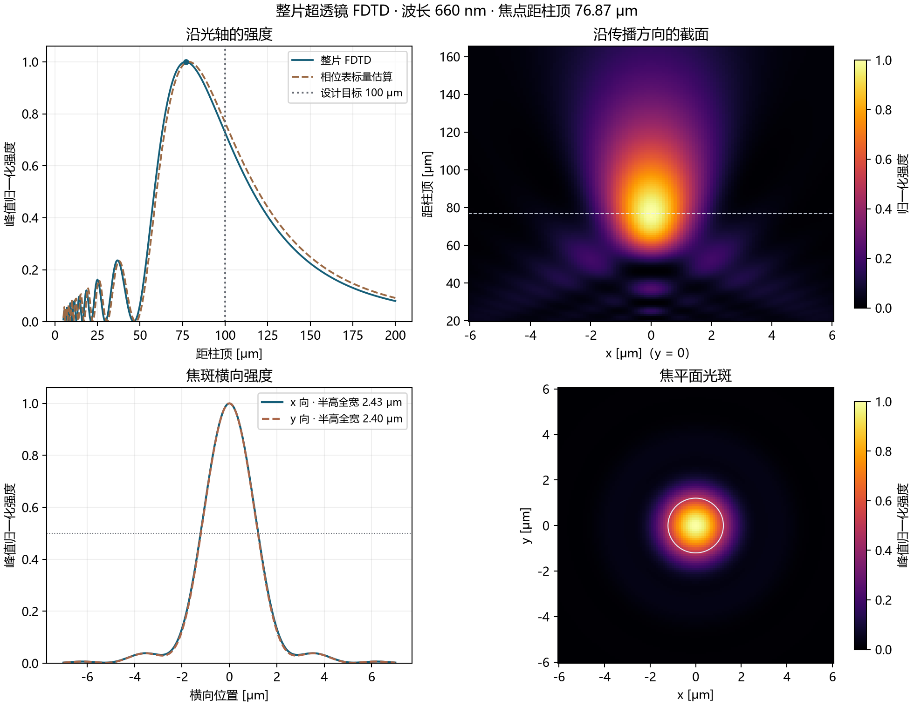
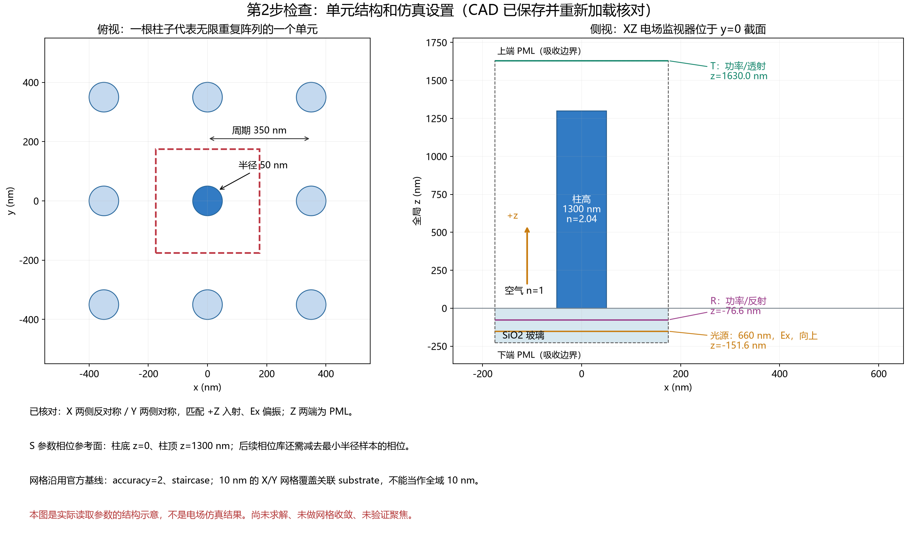
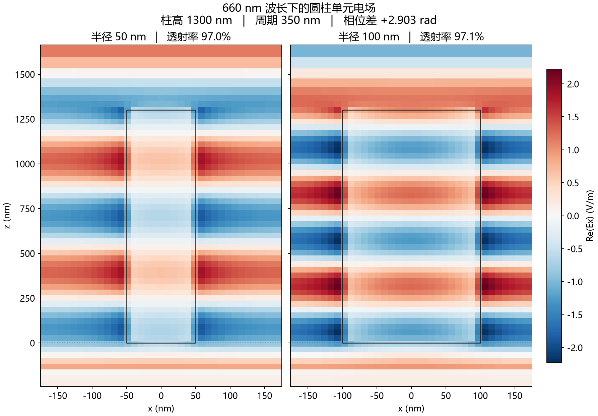
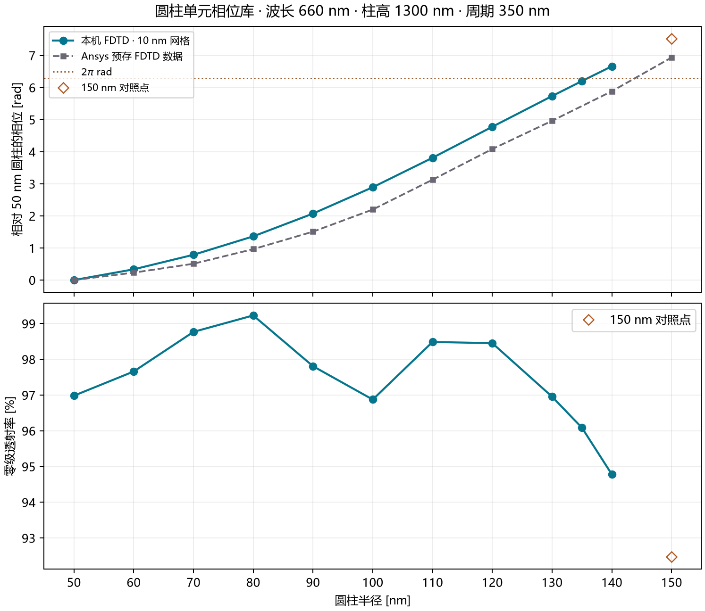
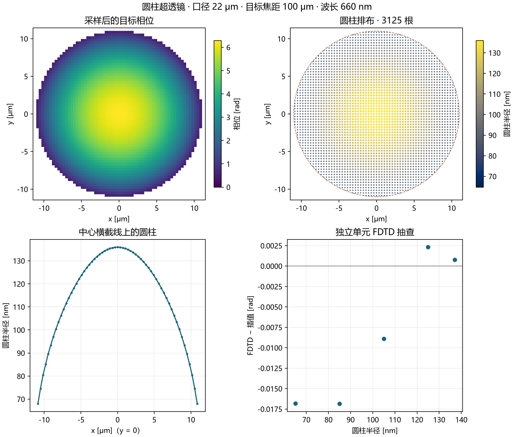

# Ansys Lumerical FDTD 小口径超透镜复现

> 更新（2026-11-24，660 nm 圆柱超透镜六步复现）。本案例使用 Lumerical FDTD 2026 R1（8.35.4413），用于自由空间聚焦仿真参考。参数对应教程示范结构。

整片仿真得到的轴上强度峰值在**柱顶上方 76.87 μm**，相对 100 μm 的设计目标提前 **23.13 μm**。焦斑强度半高全宽为 **2.43 μm × 2.40 μm**。下图从同一次求解的 660 nm 透射场投影得到。 [Ansys Small-Scale Metalens 教程](https://optics.ansys.com/hc/en-us/articles/360042097313-Small-Scale-Metalens-Field-Propagation)



汇报时可直接使用[六页复现汇报稿](2026-11-26_Ansys_FDTD_超透镜复现汇报.md)，其中列出各页的配图、口播和数值核验边界。

## 1. 固定复现参数

从 Ansys 教程附件取得 `unit_cell_fdtd.fsp` 和 `full_lens.fsp`，分别建立单元与整片工作副本。运行前核对 FDTD CPU 资源、材料、监视器输出和单位。教程预存的 FDTD 数据可用于对照。

| 项目 | 设置 |
| --- | --- |
| 波长和传播介质 | 真空波长 660 nm，聚焦在空气中 |
| 晶格和柱高 | 350 nm 方格，圆柱高 1300 nm |
| 圆柱和基底 | 各向同性恒定介质 n = 2.04、k = 0；`SiO2 (Glass) - Palik` 基底 |
| 入射 | 平面波从玻璃侧沿 +z 正入射，电场沿 x |
| 透镜 | 名义直径 22 μm，目标焦距 100 μm，自圆柱顶面起算 |

## 2. 检查周期单元模型

打开 `unit_cell_fdtd.fsp` 的工作副本，设置柱高 1300 nm、半径 50 nm 和方格周期 350 nm。基底顶面与柱底位于 z = 0。x 两侧取反对称，y 两侧取对称，z 两端用 PML。确认 `s_params` 的参考面对应柱底及柱顶，打开 y = 0 截面的场监视器。以下是按模型参数绘制的结构检查图。



## 3. 先求解两个半径

保持其他参数相同，分别用教程基线网格计算半径 50 nm 和 100 nm。读出同偏振零级复透射系数 `S21_Gn`，用 50 nm 的相位作为参考。两个单元的透射率分别约为 97.03% 和 97.10%，相位差约为 2.903 rad。下面两幅图比较 y = 0 截面的电场实部。功率透射率由功率监视器读取。 [Ansys S 参数提取](https://optics.ansys.com/hc/en-us/articles/360042095873-Metamaterial-S-parameter-extraction)



## 4. 扫描半径，建立相位库

使用共形网格，圆柱附近的三轴最大步长设为 10 nm。时域源用 40 fs 高斯脉冲，峰值延迟 160 fs，频域监视器只取 660 nm。半径从 50 nm 扫到 150 nm，间隔 10 nm，并补算 135 nm。沿半径顺序展开 `arg(S21_Gn)`，减去 50 nm 的相位。50–140 nm 的 11 个采样点得到单调相位曲线，零级透射率为 94.78%–99.23%。对相邻点做线性插值，0–2π 对应的半径约为 50.00–135.88 nm。150 nm 额外保留为对照点。

将 50、100、140 nm 三个点从 10 nm 网格加密到 7 nm，最大相位变化为 0.0069 rad，透射率最大变化为 0.146 个百分点。100 nm 的本机相位为 2.8933 rad，教程预存 FDTD 值为 2.1986 rad。约 0.695 rad 的差异来源尚未确定，后续排布采用本机相位库。 [数值相位库](../../../experiments/ref_ansys_fdtd_metalens_660nm/phase_library.json)



## 5. 用相位库选柱，生成透镜排布

以透镜中心为原点，生成周期 p = 350 nm 的正方格，选取圆柱中心到原点的距离 ρ ≤ 11 μm 的位置。用空气中的双曲相位计算每个位置的目标相位。这里采用中心相位 2π，以便整段相位连续下降。

```text
δL = sqrt(f² + ρ²) − f
φ  = 2π − (2π/λ) × δL
柱半径 = 在本机相位库中以 φ 反查半径，采用分段线性插值
```

布局共 3,125 根圆柱。中心半径 135.88 nm，最外圈半径 64.77 nm，最小边缘间距 78.31 nm。完整圆柱的最外缘达到距中心 11.055 μm。在 65、85、105、125、137 nm 五个半径补做独立单元 FDTD，插值相位的最大绝对差为 0.0169 rad。整片模型使用模板中的基底、PEC 开口和求解域，将 [逐柱坐标与半径表](../../../experiments/ref_ansys_fdtd_metalens_660nm/lens_design.json) 写入结构组，创建原生 Circle 对象。



## 6. 求解整片，投影光场并测量焦斑

整片 FDTD 使用 31 μm × 31 μm 的横向区域，z 范围为 −0.30 至 1.60 μm，共形网格的 mesh accuracy 为 2。保留 x、y 内侧的反对称与对称边界，外侧及 z 两端使用 PML。采用 40 fs 入射脉冲，透射面监视器设置在 z = 1.365 μm，保存 660 nm 的复电场与磁场。用 `farfieldexact3d` 投影到空气中，先沿轴扫描 5–200 μm，再以 0.025 μm 的步长复查峰值附近。焦斑宽度由峰值所在平面上两个横向中心截面的半高交点求得。 [Ansys 场投影命令](https://optics.ansys.com/hc/en-us/articles/360034930733-farfieldexact3d-Script-command)

| 测量项 | 本机结果 |
| --- | ---: |
| 焦点距柱顶 | 76.87 μm |
| 目标距离处的轴上强度 | 峰值的 72.7% |
| 焦斑半高全宽 x 向 | 2.43 μm |
| 焦斑半高全宽 y 向 | 2.40 μm |
| 同相位表、同口径的标量传播峰值 | 78.67 μm |

16 个本机 CPU 进程用时约 324 秒。残场指标降至 9.36 × 10⁻⁶，达到 10⁻⁵ 自动停机阈值。投影采样由每波长 4 点加到 8 点后，焦点仅变化约 0.0041 μm，横向半高全宽变化小于 0.001 μm。有限口径的标量对照也出现焦点前移。整片 FDTD 的空间网格加密仍待单独验证。

[归档说明与数据](../../../experiments/ref_ansys_fdtd_metalens_660nm/README.md) · [焦点测量值](../../../experiments/ref_ansys_fdtd_metalens_660nm/focus_metrics.json) · [投影数据](../../../experiments/ref_ansys_fdtd_metalens_660nm/focusing_fields.npz)
