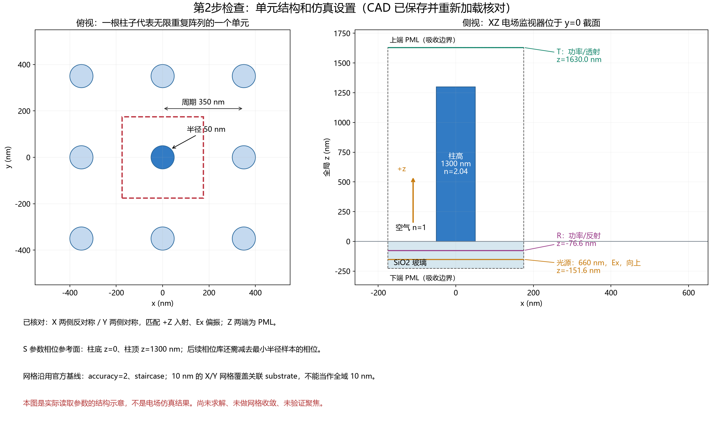
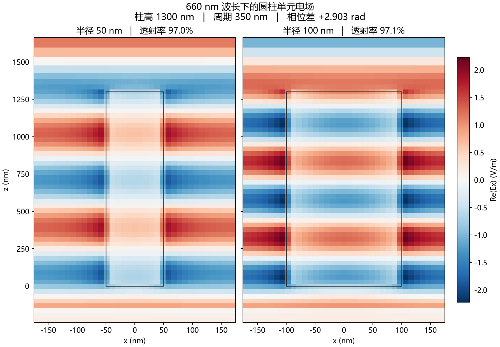

# Ansys FDTD 小口径超透镜复现汇报

> 更新（2026-11-26，六页汇报提纲）。图表来自 Lumerical FDTD 2026 R1 本机复现。具体模型设置、操作与原始数据见[六步复现记录](2026-11-24_Ansys_FDTD_小口径超透镜.md)。

**汇报主线**　先用单元仿真回答「不同半径能提供多少相位」，再按目标相位排布整片超透镜，最后从实际算出的透射场读出焦距和焦斑。

## 第 1 页｜想复现什么

**放图**　下方周期单元的俯视与侧视图。介绍光从玻璃侧入射，穿过不同半径的圆柱后再在空气中汇聚。

| 参数 | 教学案例取值 |
| --- | --- |
| 真空波长 | 660 nm |
| 圆柱与晶格 | 柱高 1300 nm，折射率 n = 2.04，正方晶格周期 350 nm |
| 透镜 | 名义口径直径 22 μm，目标焦距 100 μm |
| 基底与入射 | Palik 玻璃，沿 +z 法向入射，电场沿 x |

**讲稿**　“这个案例用等高圆柱控制光的相位。我们先把一格算准，再根据每个位置所需的相位确定柱半径，最后检查整片聚焦。”

来源 [Ansys Small-Scale Metalens 官方教程](https://optics.ansys.com/hc/en-us/articles/360042097313-Small-Scale-Metalens-Field-Propagation)。

## 第 2 页｜先验证半径能调相位

**放图**　半径 50 nm 和 100 nm 两种圆柱的 y = 0 电场截面。看同一色标下出射波纹的位置差异，再报读数。

**讲稿**　“只改半径，其余条件相同。两个单元的功率透射率都约 97%，但零级透射相位相差 2.903 rad，约 166°。这就是后面用不同半径拼出目标波前的依据。”

相位取同偏振零级复透射系数 `S21_Gn` 的相角。以 50 nm 的相位作为零点，透射功率由功率监视器读取。

## 第 3 页｜把离散半径变成可反查的相位库

**放图**　上图读相位，下图读零级透射率。标出 2π 与本机曲线的交点。

**讲稿**　“逐点扫描圆柱半径，把跨过 ±π 的相位接回一条连续曲线。以 50 nm 为零点，线性插值得到 0–2π 对应 **50.00–135.88 nm**。下一步用这张表把目标相位换成半径。”

- **取样与透射率。** 50–140 nm 共 11 个入库点，零级透射率 **94.78%–99.23%**。150 nm 保留为额外对照。
- **单元网格抽查。** 50、100、140 nm 从 10 nm 加密到 7 nm，最大相位变化 0.0069 rad，最大透射率变化 0.146 个百分点。
- **与教程预存库的差异。** 半径 100 nm 处，本机相对相位为 2.8933 rad，教程预存值为 2.1986 rad。差异原因尚未确定，整片排布采用本机相位库。

## 第 4 页｜按目标相位反查半径，排成整片

**放图**　左上是目标相位，右上是柱子排布，左下显示中心粗、边缘细。

**讲稿**　“从边缘到焦点的光程更长，所以要给边缘配置更低的透射相位。以中心 2π 为相位参考，在 350 nm 的方格上计算每个位置的相位，从库里反查柱半径。这样得到 3,125 根原生圆柱。”

中心半径约 **135.88 nm**，最外圈半径约 **64.77 nm**，最小柱间边缘间距 **78.31 nm**。按圆柱中心筛选名义口径内的点并保留完整圆柱。独立补算五个半径后，插值相位最大绝对差为 **0.0169 rad**，代表所抽查的单元插值误差。

## 第 5 页｜整片仿真后，怎样读出焦距和焦斑

**放图**　先看左上轴上强度曲线，再看右下焦平面光斑，最后用左下的两条截线读半高全宽。

**讲稿**　“先用整片 FDTD 得到柱顶上方透射面的复电场和磁场，再用 `farfieldexact3d` 把它们传播到空气中。沿光轴扫描，最亮位置距柱顶 **76.87 μm**。在这个焦平面上，两条正交强度截线的半高全宽分别是 **2.43 μm** 和 **2.40 μm**。”

| 看图时要说清楚的量 | 取值或定义 |
| --- | --- |
| 设计焦距 | 100 μm，自柱顶起算 |
| 本机轴上强度峰值 | 柱顶上方 76.87 μm，较目标提前 23.13 μm |
| 100 μm 处轴上强度 | 峰值的 72.7%，按单个轴上位置的强度归一化 |
| 有限口径标量传播对照 | 同相位表、同口径下，峰值在 78.67 μm |

“这个尺寸下，有限口径的衍射能让轴上最亮点提前。用同一相位表做的标量传播也出现前移，支持这个解释。Ansys 教程的整片直接仿真也报告了焦点前移，给出的焦距约为 79.4 μm。对照精确数值时需统一轴向参考面和所用相位库。” [Ansys 教程的 Full lens design 小节](https://optics.ansys.com/hc/en-us/articles/360042097313-Small-Scale-Metalens-Field-Propagation)

## 第 6 页｜核验到哪一步，怎么接上实验汇报

**讲稿**　“相位库用单元网格加密抽查过。整片求解达到自动停机阈值，后处理投影采样加密后焦点只变动约 0.0041 μm。整片 FDTD 的空间网格加密仍待单独验证。接下来把仿真里的三个动作搬到 1550 nm 台架上。”

| FDTD 教学案例 | 1550 nm 台架对应操作 |
| --- | --- |
| 定义从柱顶量起的焦距 | 在装样后先固定图案面零点，再沿轴扫焦 |
| 输出焦平面强度和 x/y 两条截线 | 标定物方像素尺寸，用相机记录二维焦斑与两个方向的 FWHM |
| 比较场分布及焦面 | 在同一照明条件和积分半径下再比较焦区功率。实验聚焦效率由独立功率标定给出 |

本次复现的 660 nm 焦距和焦斑用于核对仿真方法。1550 nm 台架的焦距、焦斑和绝对聚焦效率以同口径实测为准。

[查看实验表征光路汇报](../fabrication/2026-11-26_超透镜表征光路搭建与汇报.md) · [查看本机数据与原图](../../../experiments/ref_ansys_fdtd_metalens_660nm/README.md) · [焦点数据](../../../experiments/ref_ansys_fdtd_metalens_660nm/focus_metrics.json)
