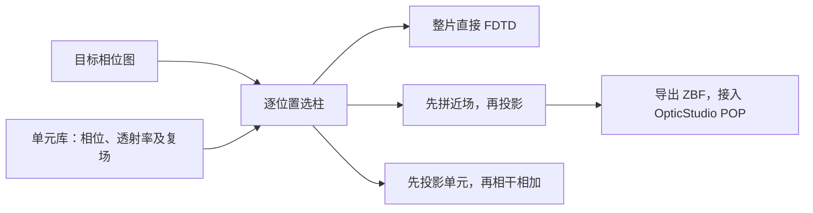
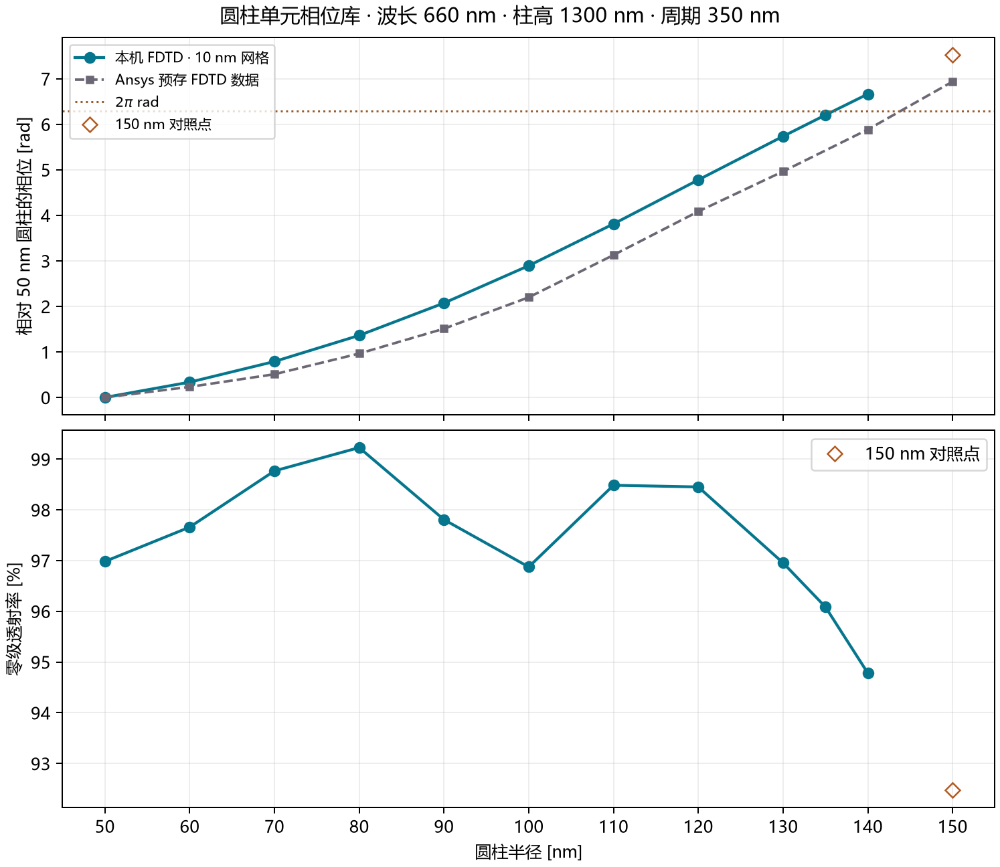
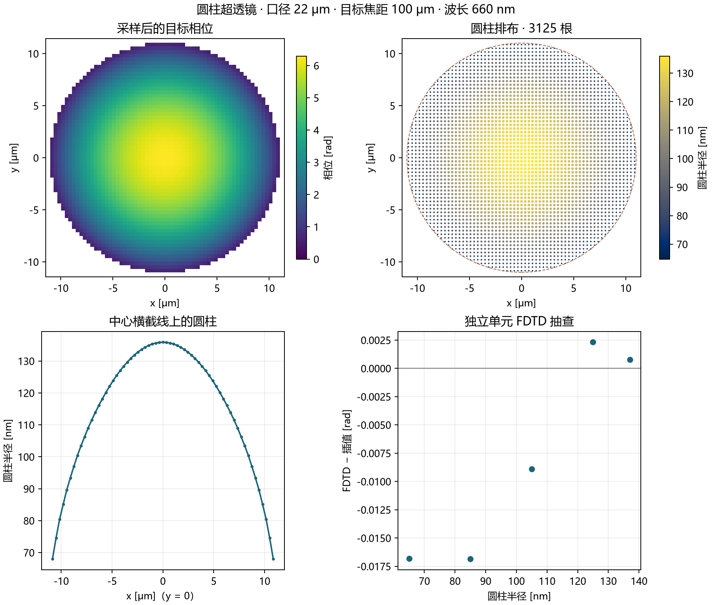
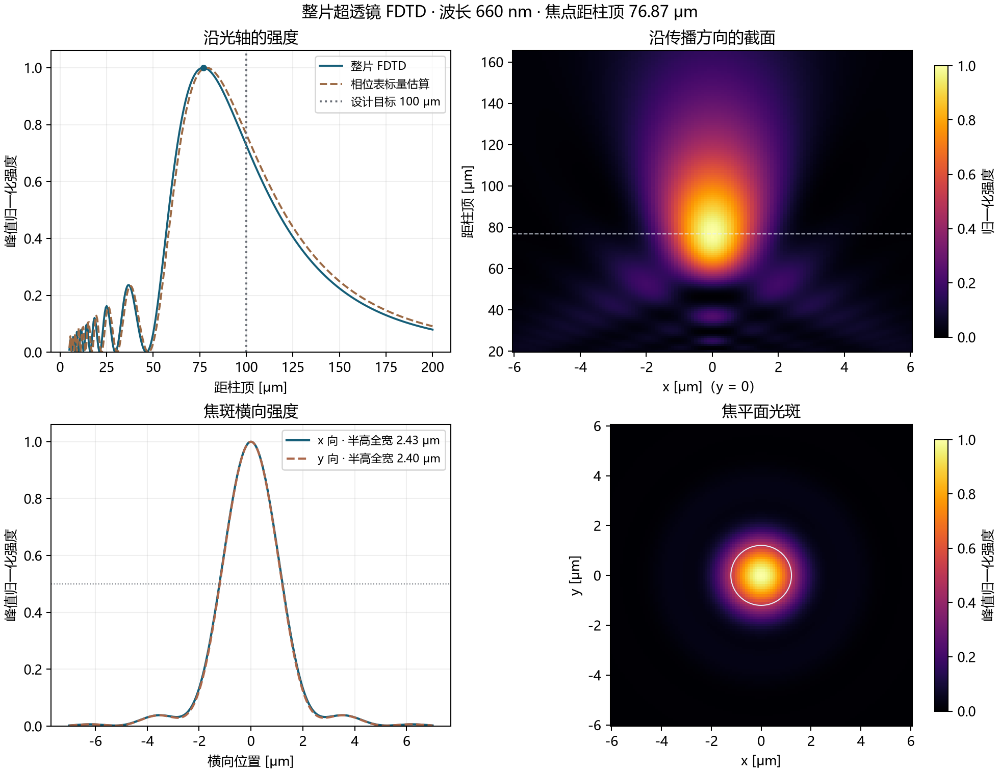

# Ansys 超透镜教程的方法对照与复现汇报

> 更新（2026-11-26，方法对照）。以官方教程的单元库、三种整片场算法和 OpticStudio 系统传播为主线。本机已跑通 FDTD 单元扫描和小口径整片直接 FDTD，其余路线以下文标注的官方演示和脚本为依据。 [Ansys 官方教程](https://optics.ansys.com/hc/en-us/articles/360042097313-Small-Scale-Metalens-Field-Propagation)

## 第 1 页｜先分清教程在做哪一层的计算

官方小口径验证用半径 11 μm 的点聚焦超透镜。公共设计输入是目标相位图、晶格和单元库。圆形点聚焦案例可用双曲相位公式。对于要和柱面镜配合的系统，教程在 OpticStudio 优化二维相位图，再送入 Lumerical 选柱。

**讲稿**　“RCWA 和 FDTD 首先可以用来建单元库。拿到同一套柱子排布以后，官方给了三种求整片光场的办法。OpticStudio POP 则把算好的出射波继续传过其他光学元件。”

## 第 2 页｜单元库怎么建，RCWA 和 FDTD 怎么选

先在周期边界下扫描柱高和半径。用相位覆盖、透射率选定柱高，再固定柱高扫描半径。对出射相位展开并统一相位零点，将「半径 → 相位」插值成可反查的关系。要做整片场重建，还需在同一出射参考面保存单元的**复电场和磁场**。

| 单元求解方法 | 怎么做 | 什么时候用 |
| --- | --- | --- |
| **RCWA（严格耦合波分析）** | 在周期结构中用傅里叶谐波表示场，逐层计算透射。在教程主线中依次做柱高和半径扫描、保存单元近场 | 周期元胞适合用分层表示、需要大量扫描几何参数时。改变保留的谐波数检查收敛 |
| **FDTD（时域有限差分）** | 在空间网格上推进时域电磁场，由频域监视器取目标波长的透射和复场。在官方附录中用 `unit_cell_fdtd.fsp` 与 `unit_cell_fdtd.lsf` 建库 | 复杂几何、材料或激励需要更一般的离散模型时。检查空间网格、监视参考面和残场 |

**本机图怎么讲。** 用 660 nm、柱高 1300 nm、周期 350 nm 建库。基线的 50/100 nm 单元透射率都约 97%，相对相位差为 2.903 rad。10 nm 共形网格的扫描中，0–2π 对应半径约 50.00–135.88 nm，入库点的零级透射率为 94.78%–99.23%。100 nm 处本机相位比官方预存 FDTD 数据高约 0.695 rad，原因尚未确定。

在汇报中把**相位和透射率表**与**空间复场库**分开说明。前者够做选柱。后两种整片重建方法还需要单元内随位置变化的复场。 [Ansys Step 2 与 FDTD 附录](https://optics.ansys.com/hc/en-us/articles/360042097313-Small-Scale-Metalens-Field-Propagation)

## 第 3 页｜方法一　整片直接 FDTD

**怎么做。** 把每个位置所需的半径变成实际圆柱，在同一个 FDTD 求解域内放入有限口径的整片透镜、照明和监视器。教程通过 PEC 开口限制入射范围。求解后读取透射面的复 E/H，用场投影计算轴向扫描和焦平面。官方入口是 `full_lens.fsp` 和 `full_lens.lsf`。

**学什么。** 透镜上不同柱子之间的耦合以及口径边缘的散射，可以在这个有限结构求解中体现。口径增大时，三维网格、计算时间和内存都会增加。可先用一片小透镜建立直接求解的对照结果。

**本机复现。** 使用本机相位库生成 3,125 根圆柱。设计焦距 100 μm，整片投影得到距柱顶 **76.87 μm** 的轴上强度峰值，焦斑半高全宽为 **2.43 × 2.40 μm**。同口径标量传播对照给出 78.67 μm 的峰值，支持有限口径引起的焦点前移。官方直接仿真给出的焦距约 79.4 μm。精确比对需统一相位库和轴向参考面。本机已做投影采样检查，整片空间网格收敛仍待核验。 [六步复现记录](2026-11-24_Ansys_FDTD_小口径超透镜.md) · [官方 Direct simulation 小节](https://optics.ansys.com/hc/en-us/articles/360042097313-Small-Scale-Metalens-Field-Propagation)

## 第 4 页｜方法二　先拼近场，再传播到焦面

1. **查单元场。** 对目标相位图的每个格点，从库中选取对应半径、相位和复 E/H 小块。所有小块使用同一参考面、方向和采样约定。
2. **拼整片面。** 将小块搬到其晶格位置，在公共采样点做加权合并。教程的 11 μm 半径案例仅在有效口径内放入单元场。
3. **向外传播。** 从拼接好的整片出射面做投影。官方脚本用 `farfieldexact3d` 计算有限距离的轴向强度和焦面，因此可以检查焦距与焦斑。入口是 `stitch_nearfield_R11um.lsf`。

**什么时候选。** 需要整片出射复场、轴向焦距或二维焦斑，而且整片三维 FDTD 已经偏重时。这里的加速来自复用周期单元场。每块对应的是该种圆柱在重复邻居中的响应，实际相邻柱径突变时的额外耦合需要另作核验。

**讲稿**　“先在透镜出口拼一张带振幅和相位的整片波前，再让它往前传播。官方小口径对照表明，近场振幅受照明开口和局部周期近似影响，焦距和焦斑仍能与直接仿真较好对应。” [官方 Nearfield stitching and far-field projection 小节](https://optics.ansys.com/hc/en-us/articles/360042097313-Small-Scale-Metalens-Field-Propagation)

## 第 5 页｜方法三　先投影单元，再把远场相加

1. 把单元库中各状态的近场分别投影一次，得到同一角度网格上的**复矢量远场库**。教程脚本调用 `farfieldvector3d`。
2. 给每根柱子选对应场，再加上由柱子坐标和观察方向决定的**位置相位因子**。教程脚本在其相位约定下使用 `exp(i·kx·x + i·ky·y)`。
3. 同一观察方向上的**复电场先相干求和，再取模平方**，得到角度强度图。保留相位，才能显示加强和抵消产生的主瓣与旁瓣。入口是 `sum_farfield_R11um.lsf`。

**什么时候选。** 重点是远场角分布、主瓣和旁瓣，并希望复用单元方向场库时。这个官方脚本用 1 m 半球上的角分布和整片 FDTD 对照。有限距离的焦点和焦斑宽度，使用第 3 或第 4 页的轴向与焦面计算读取。

**和近场拼接的关系。** 两条路线共享局部周期单元库和线性传播的思路。近场拼接是在透镜出口合成光场，远场相加是在各观察方向合成光场。比较结果时应统一照明、口径、单元选态和输出坐标。 [官方 Summing the farfields of unit cells 小节](https://optics.ansys.com/hc/en-us/articles/360042097313-Small-Scale-Metalens-Field-Propagation)

## 第 6 页｜从单片到系统，怎么接 OpticStudio

教程的大口径例子采用半径 **100 μm** 的超表面，与柱面镜配合。两次软件交接分别传不同数据。

1. **OpticStudio → Lumerical。** 在系统里用理想衍射面优化目标相位。导出二维相位图，再到 Lumerical 用单元库选定实际圆柱。
2. **Lumerical → OpticStudio。** 用 `stitch_nearfield_ZOS_R100um.lsf` 拼出整片近场，导出 `Enear_lens_extended.zbf`。在 OpticStudio 的 **POP（物理光学传播）** 中从超表面后的输入面将波前继续传播，通过系统中的其他光学元件。
3. **比较系统结果。** 在相同系统条件下比较 ZBF 场和理想相位面的焦面分布。官方例子用此对照检验单元选态和整片波前在系统中的效果。

教程还给出 `gds_export.lsf`，把选定圆柱的横截面轮廓按晶格位置写入 GDS。它属于版图交付。 [官方 OpticStudio propagation 与 GDS export 小节](https://optics.ansys.com/hc/en-us/articles/360042097313-Small-Scale-Metalens-Field-Propagation)

## 汇报结尾｜用一个小例验证，把哪一步留给大口径

| 手上的问题 | 方法 | 主要输出 |
| --- | --- | --- |
| 想取得有限小透镜的全波对照 | 整片直接 FDTD | 透射面复场、焦距、焦斑 |
| 想预测更大口径的焦面，同时保留出射波前 | 单元近场拼接，再传播 | 整片近场、轴向强度、焦平面 |
| 想看光射向哪些角度 | 单元复远场相干相加 | 角度强度图、主瓣及旁瓣 |
| 想看超表面与后续镜组共同成像 | 近场导出 ZBF，再做 OpticStudio POP | 系统各面波前和焦面分布 |

**如果继续做本机对照**，可沿用现有 660 nm 的半径排布，补齐同一参考面的单元复 E/H 库。用同一轴向原点和照明口径逐项对比整片直接 FDTD 与近场拼接的轴上峰值、两个方向的焦斑半高全宽和归一化方式。远场相加另用相同角度网格对比角分布。实际台架的对应读法见[1550 nm 表征光路与功率标定汇报](../fabrication/2026-11-26_超透镜表征光路搭建与汇报.md)。

[本机复现流程](2026-11-24_Ansys_FDTD_小口径超透镜.md) · [结果与数据](../../../experiments/ref_ansys_fdtd_metalens_660nm/README.md)
